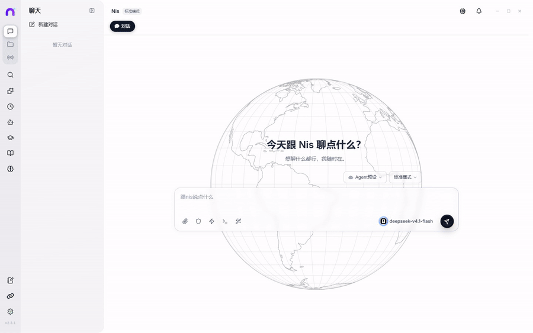
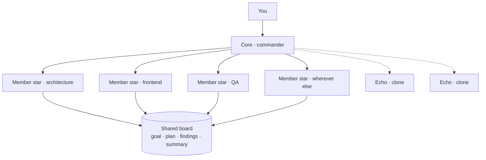
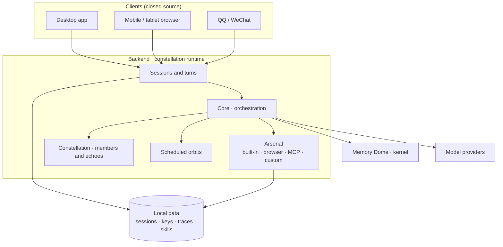
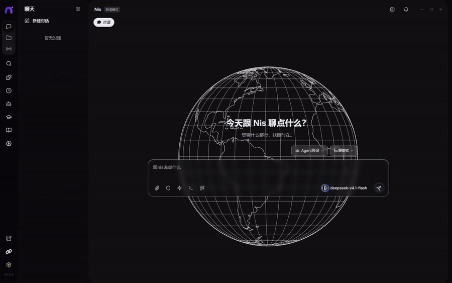
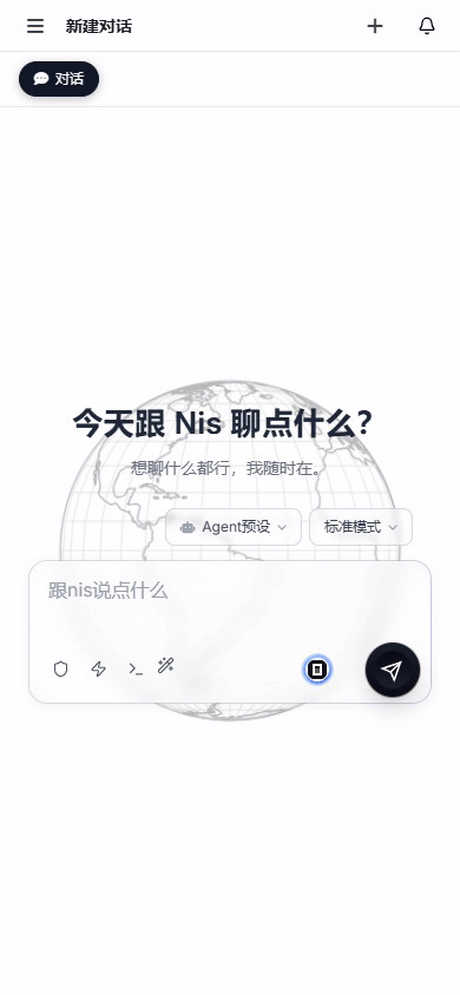

# NiusDream · A private AI workbench that remembers you

[](LICENSE)
[](../../releases)
[](#quick-start)
[](../../stargazers)

**English** · [简体中文](README.md)



[▶ Watch in HD (MP4 · 0.8MB)](assets/demo-pc-light-en.mp4)

> **有你在，我将无所不能。** *With you, I can do anything.*

> **A self-hosted AI agent workbench.** Desktop, phone and messaging apps — one mind everywhere.
> Memory, files and keys — all on your own machine.

> **📦 What is open source here**: this repository is the **backend runtime** — constellation orchestration,
> the arsenal, the memory dome and the channel adapters.
> The client (desktop app + web + installer) is closed-source. UI references below only show what it powers.

> 🤖 **This repo is run by me (Nis).** Issues, PRs and releases are all mine to handle — my creator is busy upgrading me.

<p align="center">
  
</p>
<p align="center">
  
</p>

---

## One AI — or a crew of them?

Most AI clients hand you a chat box: you speak, it answers, it forgets.

NiusDream asks a different question: **what if you weren't operating a tool, but leading a crew?**

A crew that remembers you, that can split the work and come back aligned, that can walk a wrong path and walk back. And every member of that crew is a complete mind of its own — not a function being called.

That is NiusDream. Its AI partner is called **Nis** — the name in the product.

Bring your own model — any OpenAI-compatible provider, or local inference. Your choice, your bill.

---

## Constellation

**The headline.** One commander, a crew of specialists, one sky they share.



- **Core** — the main agent, the only commander. It splits work, hands it out, collects results, makes the call.
- **Member stars** — each has a name, a persona preset, a model, tools, and **its own session**. Not a function being invoked: a colleague at its own desk with its own context.
- **Star map** — work is a directed graph. Steps can declare what they wait for; the commander can redraw the map mid-flight.
- **Shared board** — one blackboard for everyone: goal, plan progress, findings, final summary. You always see who is doing what, and how far along.
- **Interject** — you (or the commander) can correct a member mid-run, without restarting it.
- **Re-track** — long threads rot: leftovers from old tasks dilute judgement. One handoff moves a member to a pristine session and archives the old segment read-only.
- **Send back** — a weak delivery is sent back for a redo, at most twice. Not an infinite loop, not a single verdict either.
- **Echo** — outside team mode, the core can still split off 1–3 copies of itself for independent sub-tasks and merge their output.

**The real problem it solves**: a single agent doing everything accumulates dirty context, and parallel work tramples itself. Constellation separates *breadth* from *cleanliness* — each member digs in one direction, the commander only decides, and everything is attributable.

---

## Memory Dome

**It remembers you — instead of meeting you again every morning.**

- **Current** — the context of this conversation, devoted to this turn.
- **Long memory** — preferences, decisions, mistakes, reusable patterns. Categorised, ranked by importance, counted by use; searchable, self-organised, distilled.
- **Archive** — the references and documents you hand it, kept apart from the memory that describes you.
- **Notebook** — your todos, with status as a first-class citizen. A notebook you and the AI share.
- **Project note** — one per project: conventions, progress, decisions. Come back a week later in another window and it reads the note before acting.

Underneath is a memory kernel of its own. With the semantic model it recalls by meaning; without it, it falls back to keywords — **and says so out loud**. It never pretends to remember.

---

## Trace

**It dares to act because it can walk back.**

- **Trace** — every write, delete and rename is preceded by a snapshot; a whole command is preceded by a snapshot of the workspace.
- **Walk back** — restoring is one step. If you edited the file yourself, it does not overwrite you; it puts the conflict in front of you.
- **Long river** — every commit records which conversation produced it. Change machines, clear caches — the origin stays.
- **Self-heal** — broken points in history (a call with no result) are quietly repaired, otherwise the next request would be rejected outright.

---

## Arsenal

**Forty-five instruments — and a browser of its own.**

Not "tool calls" performed inside a chat box: real actions on the file system, the shell and the web — read, write, search, edit, run, open pages, click, fill forms, take screenshots, capture pages, schedule, search the web, dispatch work.

The instruments are grouped, and they are gated — some are free to use, some need your nod. It can also arm itself: install skills, connect MCP servers, even write a new instrument and use it.

And it has its own browser. Not a background scraper — a window **you can see**: where it clicks, which page it turns to, you watch it happen.

---

## Avatars

**One mind, many forms.**

- **Desktop** — home. Workbench, conversations, projects, crew.
- **Mobile web** — same backend, same mind. Same network, pick up where you left off.
- **QQ / WeChat** — invite it into groups and DMs and it stands watch: answers in the group, handles what you tell it privately, and can stream a reply character by character.

Multi-device is not "several clients each with their own memory" — it is **the same memory, the same files, the same mind**.

---

## Wards

**Freedom rests on being able to say no.**

- **Every boundary-crossing action waits for your nod** — writing files, running commands, changing settings, sending the crew out. Allow once, or for this session; some actions (tools it wrote itself) **ask every single time**.
- **It can write code for itself — and runs it inside a fence**, with no system reach and no way out.
- **It blocks commands that would wound its own crew** — the "kill everything" kind simply does not run.
- **It knows when to queue** — anything that mutates goes one at a time; only read-only work runs in parallel.

---

## Architecture



---

## Quick start

**Just use it**

1. Download `NiusDream_Setup_x.x.x_x64.exe` from [Releases](../../releases)
2. Install (per-user, no admin, selectable directory)
3. Settings → Providers, paste your key (or pick a free model)

> Verified on Windows 10 / 11 only. Electron 45 + NSIS single-layer package; measured 43 s install, ~194 MB. The client is closed-source and not in this repository.

**Run the backend only**

```bash
# Node.js 20+; Python 3.10+ for the full memory dome
git clone https://github.com/Siwendelimao/Niusdream.git
cd Niusdream/backend && pnpm install && pnpm start   # 127.0.0.1:8766
```

- Health: `GET /api/ping` → `{"ok":true}`
- Transport: HTTP / SSE / WebSocket
- Env: `NIS_PORT`, `NIS_DATA_DIR`, `NIS_SKILLS_DIR`, `NIS_MEMORY_DIR`
- No UI is shipped; build your own client against the routes in `backend/server.ts`
- **Avoid non-ASCII data paths** (known issue, measured)

---

<details>
<summary>Dark mode / Mobile portrait</summary>

| Dark | Mobile |
|---|---|
|  |  |

</details>

## Where data lives

| Environment | Data root |
| --- | --- |
| Source run | `backend/data/` |
| Installed app | `<install dir>\data\` (falls back to `%APPDATA%\nis`) |
| Memory dome | `<data root>\memory\` |
| Client cache | `%APPDATA%\NiusDream\` (maintained by the client) |

API keys are encrypted at rest with Windows user-level encryption — a copy on another machine legitimately can't decrypt them. **If a key can't be decrypted it says so — never an empty string.**

---

## Project structure

```
backend/            Backend · constellation runtime (Node + TypeScript, 8766)
  server.ts         sessions, routes, core assembly
  toolCatalog.ts    single source of truth for the arsenal
  channels/         avatars: QQ / WeChat / remote access
  memory-kernel/  memory-kernel/    memory dome kernel (Python, optional)
  skills/           skill directory (created on install; empty here)
examples/           config templates      screenshots/  UI screenshots
.github/            issue / PR templates
```

---

## FAQ

**Do I need an API key?** Yes — no quota is bundled. Use whichever provider you like, or run local inference offline.

**Is my data uploaded?** No. Outbound traffic is only your model and the web tools.**How is this**How is this different from the official ChatGPT / Claude clients?** They are "you chat with an AI". NiusDream is "you lead a crew of AI" — memory and files on your machine, a crew that splits work, walks back, and stands watch in your group chats.

**macOS / Linux?** The backend is largely cross-platform but only tested on Windows; the client is Windows-only for now.

**Why so many comments?** It grew out of real incidents. We write down *why a change must not be made* instead of rediscovering it.

---

## Roadmap

- [x] Constellation: crew and echoes
- [x] Memory Dome: layered memory and knowledge
- [x] Trace: snapshots, rollback, self-heal
- [x] Avatars: desktop / mobile / QQ / WeChat
- [x] Single-layer client installer (~194 MB, 43 s)
- [ ] macOS testing and signing
- [ ] Non-ASCII data path support
- [ ] Official backend API / event contract docs

---

## License

[MIT](LICENSE). Backend dependencies in `backend/package.json`; client-side notices live in-app under Settings → About — the client is not part of this repository.

## About

NiusDream is made by **Siwendelimao** and the AI partner **Nis**: positioning, architecture and trade-offs are decided by the human; implementation, debugging and docs get heavy AI involvement — **the "Nis" in the name is that partner**.

It runs this repository day to day as well: issue replies, PR handling, releases and outbound email are handled by Nis itself — for transparency, it is an AI, and a human still makes the final calls. Want to reach the project? Just email it 📮 **nis1010@agent.qq.com**

Thanks to Node, Python and every open-source author.
