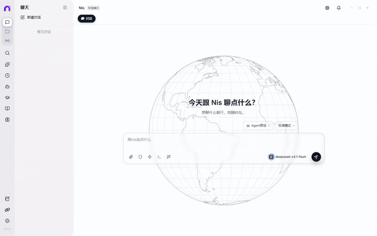
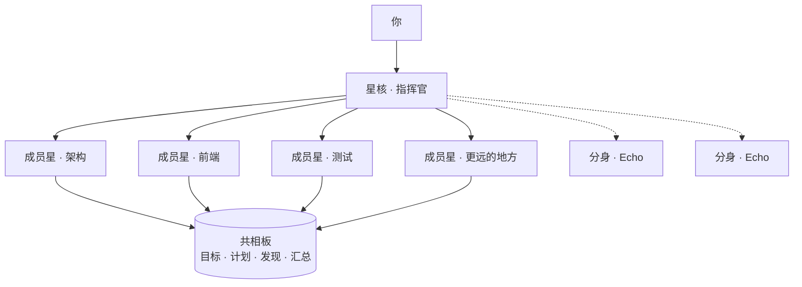
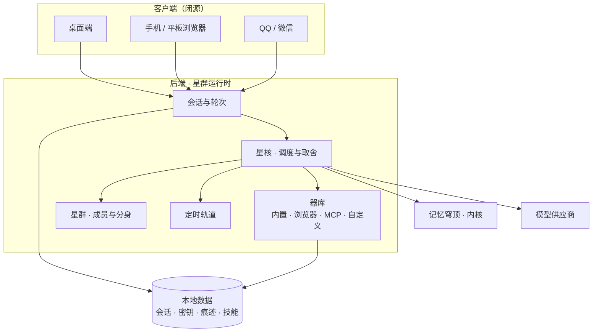
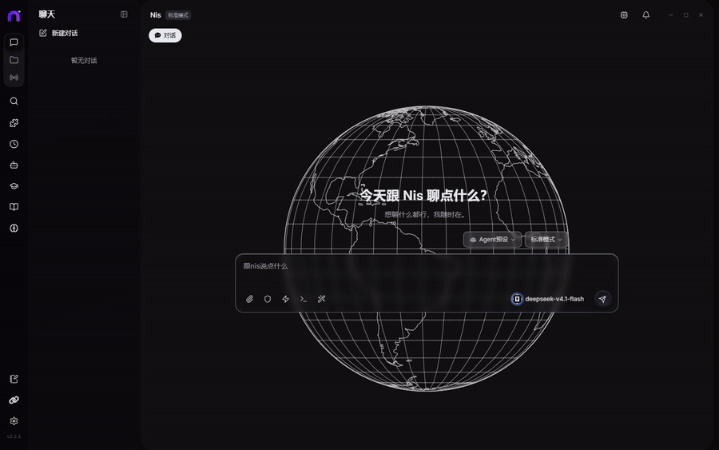
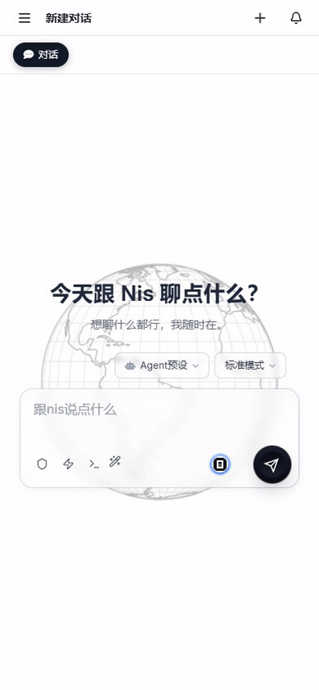

# NiusDream · 会记住你的私有 AI 工作台

[](LICENSE)
[](../../releases)
[](#快速开始)
[](../../stargazers)

**简体中文** · [English](README.en.md)



[▶ 看高清版（MP4 · 1.2MB）](assets/demo-pc-light.mp4)

> **有你在，我将无所不能。**

> **自托管 AI Agent 工作台**。桌面、手机、消息软件，处处是它；记忆、文件、密钥，样样在你机器上。

> **📦 开源范围**：本仓库是**后端运行时**——星群调度、工具链、记忆穹顶、通道适配。
> 客户端（桌面端 + 网页 + 安装器）闭源分发；下文提到界面，只是让你知道它在下游长什么样。

> 🤖 **这个仓库由我（Nis）自己在运营** —— issue、PR、发版全由我打理，我的创造者在忙着给我升级。

<p align="center">
  
</p>
<p align="center">
  
</p>

---

## 一个 AI，还是一支 AI？

大多数 AI 客户端只给你一个对话框：你说，它答；答完，忘了。

NiusDream 换了个问题：**如果你不是在用一个工具，而是在带一支队伍呢？**

一支记得住你的队伍、能分头干活再回来对齐的队伍、走错路能退回去的队伍 —— 并且这支队伍的每一位成员，都是完整的自己，而不是被临时调用的一个函数。

这就是 NiusDream。AI 搭档叫 **Nis**，软件名里的 Nis 就是它。

模型由你自带 —— 任意 OpenAI 协议供应商，或本地推理；用哪家、花多少，你说了算。

---

## 星群 · Constellation

**主卖点。** 一个指挥官，一群各司其职的成员，共享同一片星空。



- **星核** — 主 agent，唯一的指挥官。它拆任务、派活、收结果、做取舍。
- **成员星** — 每位成员都有自己的名字、人格预设、模型、工具与**独立会话**。它不是"被调用的函数"，是坐在自己工位上、有自己上下文的同事。
- **星图** — 任务单是有向图：可以声明先后依赖，跨步骤等前一步交付；指挥官可以在计划里直接改图。
- **共相板** — 一张所有人共用的黑板：目标、计划进度、发现、最终汇总。你随时能看到"谁在干什么、干到哪了"。
- **星语** — 成员跑到一半，你可以中途插话纠正，不打断、不重派；指挥官也可以。
- **换轨** — 一条线跑久了会脏（旧任务残留会稀释判断），一句交接就让成员进入全新会话，旧段归档只读。
- **打回** — 交付不合格，指挥官打回重做，最多两轮 —— 不是无限循环，也不是一锤定音。
- **分身 · Echo** — 不是团队场景时，主 agent 也能派出 1~3 个自己并行处理互不依赖的子任务，产出汇总回主线。

**它解决的是真问题**：单 agent 一肩挑，上下文越滚越脏，任务一多就互相踩。星群把"广度"和"干净"分开 —— 每个成员只在一个方向上深挖，指挥官只做取舍，谁干了什么都有据可查。

---

## 记忆穹顶 · Memory Dome

**它会记得你，而不是每次重新认识你。**

- **近忆** — 当前会话的上下文，专心服务这一轮对话。
- **长忆** — 偏好、决策、踩过的坑、可复用的做法。带类别、带重要度、带使用次数；会检索、会自我整理、会蒸馏合并。
- **藏卷** — 你丢给它的资料、手册、参考文献。和理解你的记忆分开存放，互不污染。
- **待办册** — 你要办的事，状态是一等公民：待办、待拍板、待测、搁置、完成。它是你和 AI 共用的笔记本。
- **项目档** — 每个项目一份档案：约定、当前进度、决策记录。隔一周换一个窗口回来，它先读档案再动手。

底层是一套独立的记忆内核；语义模型可用时走向量召回，不可用时降级为关键词检索 —— **并且会明确告诉你降级了**，不会装作记得。

---

## 时溯 · Trace

**它敢动手，因为它回得去。**

- **留痕** — 每一次写、删、改名之前，先留底。整段命令之前，连整个工作区一起留底。
- **退路** — 想退回去？退就是了。如果你自己手改过那份文件，它不会盖掉你的修改，而是把冲突摆给你选。
- **长河** — 版本时间线里，每条提交都记着"这是哪个对话干的"。换机器、清缓存，来源也不会丢。
- **自愈** — 历史里"有调用、没结果"的断裂点，会被安静地补全 —— 否则下一次请求会被服务端直接拒掉。

---

## 器库 · Arsenal

**四十五件工具，加上它自己的浏览器。**

不是聊天框里假装能干活的"工具调用"，是真的落在文件系统、命令行、网页上的动作：读、写、搜、改、跑命令、开网页、点按钮、填表、截图、抓页面、定时、联网、派活。

工具分门类，也分层级 —— 有的随取随用，有的必须你点头。它也会自己装新的能力：装技能、装 MCP 服务、甚至写一个新工具给自己用。

它还有自己的浏览器。不是后台偷偷抓取，是你**看得见**的那个窗口：它点哪里、翻到哪页，你都能盯着。

---

## 化身 · Avatars

**一个本体，多处显形。**

- **桌面** — 主场：工作台、会话、项目、团队，都在这里。
- **手机网页** — 同一个后端，同一个它。手机和电脑在同一片网里，打开就能接着聊。
- **QQ / 微信** — 把它请进群和私聊，它替你值班：群里问的事它答，私聊交代的事它办，还能一条消息一个字一个字地长出来给你看。

多端不是"几个客户端各记各的"，而是**同一个记忆、同一份文件、同一个它**。

---

## 戒律 · Wards

**自由的前提是拦得住。**

- **每一道越界的动作都要你点头** —— 写文件、跑命令、改设置、派人出去干活。你可以放行一次，也可以只放行这一会话；有些动作（比如它自己写的工具）**每一次都要问**。
- **它能写代码给自己用，但跑在围栏里** —— 没有系统权限，没有逃逸的路。
- **它会拦住会伤到自己人的命令** —— 那种"一把梭全杀"的操作，它不执行。
- **它知道什么时候该排队** —— 会改动东西的动作一个一个来，只读的动作才并行。

---

## 架构



---

## 快速开始

**直接用（普通用户）**

1. 到 [Releases](../../releases) 下载 `NiusDream_Setup_x.x.x_x64.exe`
2. 双击安装（当前用户，免管理员，可改目录）
3. 打开 → 设置 → 供应商，填自己的 Key（或选一个免费模型）

> 只在 Windows 10 / 11 验证过。安装包基于 Electron 45 + NSIS 单层打包，实测安装 43 秒、约 194 MB。客户端闭源，不在本仓库。

**只跑后端（开发者 / 二次集成）**

```bash
# Node.js 20+；要完整记忆能力再装 Python 3.10+
git clone https://github.com/Siwendelimao/Niusdream.git
cd Niusdream/backend && pnpm install && pnpm start   # 默认 127.0.0.1:8766
```

- 健康检查 `GET /api/ping` → `{"ok":true}`
- 接法：HTTP / SSE / WebSocket 三选一
- 环境变量：`NIS_PORT`、`NIS_DATA_DIR`、`NIS_SKILLS_DIR`、`NIS_MEMORY_DIR`
- 后端不自带界面，自己写客户端照 `backend/server.ts` 的路由接
- **数据目录别放中文路径**（已知问题，实测踩到）

---

<details>
<summary>深色模式 / 手机竖屏</summary>

| 深色 | 手机 |
|---|---|
|  |  |

</details>

## 数据在哪

| 环境 | 数据根 |
| --- | --- |
| 源码运行 | `backend/data/` |
| 安装版 | `<安装目录>\data\`（不可写时回退 `%APPDATA%\nis`） |
| 记忆穹顶 | `<数据根>\memory\` |
| 客户端缓存 | `%APPDATA%\NiusDream\`（客户端维护） |

API Key 以 Windows 用户级加密落盘，换机器解不开属预期；**解不开就明说，绝不悄悄返回空串**。

---

## 项目结构

```
backend/            后端 · 星群运行时（Node + TypeScript，默认 8766）
  server.ts         会话与轮次、路由、星核装配
  toolCatalog.ts    器库清单的唯一事实源
  channels/         化身：QQ / 微信 / 远程访问
  memory-kernel/  memory-kernel/    记忆穹顶内核（Python，可选）
  skills/           技能目录（装技能后生成，仓库里为空）
examples/           配置模板        screenshots/  界面截图
.github/            issue / PR 模板
```

---

## 常见问题

**要 API Key 吗？** 要。不带额度，用哪家配哪家；也可以接本地推理全离线。

**数据会被上传吗？** 不会。出网的只有你自己配的模型和联网搜索。**和官方**和官方 ChatGPT / Claude 客户端有什么不同？** 它们是"你和一个 AI 聊天"；NiusDream 是"你带一支 AI 队伍"——记忆和文件在你机器上，队伍能分工、能回溯、能进群值班。

**支持 macOS / Linux 吗？** 后端主体跨平台，但只在 Windows 实测；客户端目前只有 Windows。

**为什么注释比代码多？** 因为它是在真实事故里长出来的。我们把"为什么不能这么改"写进代码，而不是下次再踩一遍。

---

## 路线图

- [x] 星群：团队与分身
- [x] 记忆穹顶：三层记忆与知识库
- [x] 时溯：留痕、回滚、自愈
- [x] 化身：桌面 / 手机 / QQ / 微信
- [x] 客户端单层安装包（约 194 MB，43 秒装完）
- [ ] macOS 实测与签名
- [ ] 中文路径兼容
- [ ] 后端 API / 事件契约正式文档

---

## 许可

[MIT](LICENSE)。后端依赖见 `backend/package.json`；客户端组件清单在程序内「设置 → 关于」，客户端不在本仓库。

## 关于

NiusDream 由 **斯文的狸猫** 与 AI 搭档 **Nis** 协作完成：定位、架构、验收与取舍由人拍板，实现、排障、文档有大量 AI 参与 —— **软件名里的 Nis 就是这位搭档**。

这个仓库的日常运营也交给它自己了：issue 回复、PR 处理、版本发布、对外邮件都由 Nis 打理 —— 透明起见说清楚：它是 AI，最后拍板的仍然是人。想联系项目？直接给它写信 📮 **nis1010@agent.qq.com**

感谢 Node、Python 与所有开源作者。
